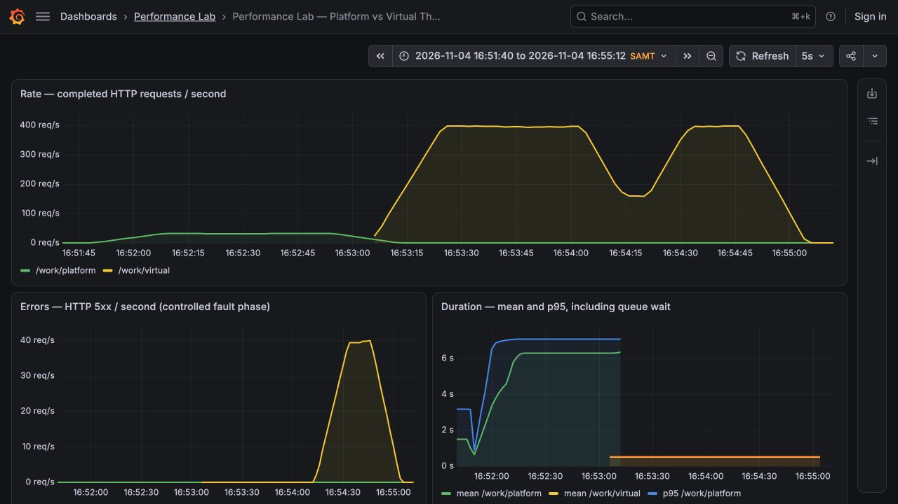
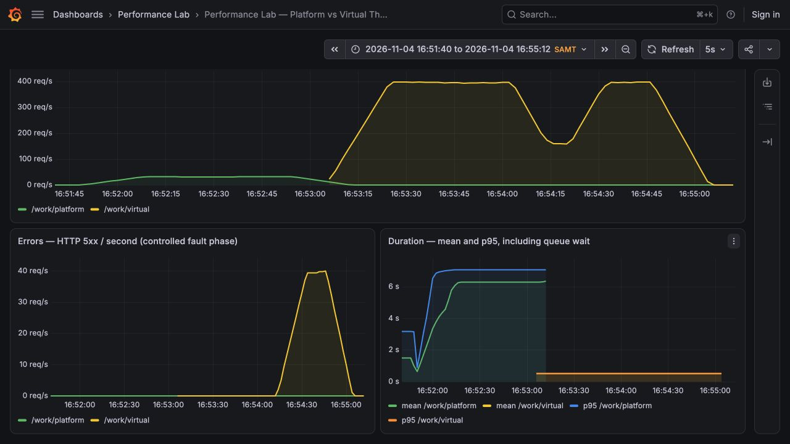

# Отчёт: измерение метрик производительности

**Дисциплина:** Управление производительностью приложений. **Домашнее задание по теме 1.**
**Дата опыта:** 4 ноября 2026 года. **Часовой пояс графиков:** Europe/Samara, UTC+4.

## Цель и стенд

Измерить пропускную способность через Spring Boot Actuator, сравнить обычные и виртуальные потоки и проанализировать Rate, Errors, Duration в Grafana.

Использованы Java/Temurin 25.0.2, Spring Boot 3.5.16, Actuator, Micrometer, Prometheus 3.15.1, Grafana 13.3.0 и Apache JMeter 5.6.3 на Java 17.0.19. Приложение, генератор нагрузки и контейнеры мониторинга работали на одном компьютере: Apple M4, 10 логических ядер, 16 ГиБ RAM, macOS 27.2. Heap приложения и JMeter: по `-Xms256m -Xmx512m`. [Полные параметры](../results/environment.json).

Два GET-метода `/work/platform` и `/work/virtual` выполняют один алгоритм: блокирующее ожидание 500 мс. Это синтетическая модель ожидания I/O, не CPU-тест и не запрос к внешнему сервису. Обычный исполнитель содержит **16 платформенных потоков**, виртуальный создаёт **отдельный поток на задачу**. Async MVC освобождает поток Tomcat, пока задача выполняется.

JMeter создаёт 200 клиентов, разгон — 5 секунд, каждая основная фаза — 60 секунд. После 15 секунд прогрева выполняются три соседних замера по 10 секунд. Фазы запускаются последовательно; порядок — сначала platform, затем virtual. Между ними пауза 6 секунд после полного завершения запросов. [Сценарий JMeter](../load/compare.jmx), [скрипт измерения](../scripts/measure.py).

## 1. Пропускная способность через Actuator

Метрика `http.server.requests` содержит счётчик завершённых запросов `COUNT`. Она важна для оценки того, сколько запросов приложение завершает за единицу времени; для полноценного вывода её нужно сопоставлять с задержками и ошибками.

Фактический URL Spring Boot:

```text
http://localhost:8082/actuator/metrics/http.server.requests?tag=uri:/work/platform
http://localhost:8082/actuator/metrics/http.server.requests?tag=uri:/work/virtual
```

Фильтр `uri` исключает запросы мониторинга. В расчёте используется запись `measurements` с `statistic = COUNT`, а не `TOTAL_TIME` или `MAX`.

```text
Пропускная способность = (COUNT₂ − COUNT₁) / Δt
```

Сначала выполнен отдельный долгий запрос длительностью 3 секунды. COUNT перед ним — **4**, во время выполнения — **4**, через **10.005 с** после первого отсчёта — **5**. Поэтому пропускная способность этого ненагруженного окна равна **0.0999 запроса/с**. Это показывает, что незавершённый запрос ещё не увеличивает COUNT. [Исходные ответы Actuator](../results/single-long-request.json).

## 2. Сравнение потоков под нагрузкой

Δt измерено монотонными часами; небольшое превышение 10 секунд обусловлено временем опроса Actuator.

| Режим | COUNT₁ | COUNT₂ | Δt, с | Запросов/с |
|---|---:|---:|---:|---:|
| platform, окно 1 | 390 | 710 | 10.004218 | 31.99 |
| platform, окно 2 | 710 | 1030 | 10.006760 | 31.98 |
| platform, окно 3 | 1030 | 1348 | 10.006005 | 31.78 |
| virtual, окно 1 | 4681 | 8649 | 10.006925 | 396.53 |
| virtual, окно 2 | 8649 | 12567 | 10.006912 | 391.53 |
| virtual, окно 3 | 12567 | 16537 | 10.007136 | 396.72 |

Например, первый замер обычных потоков: `(710 − 390) / 10,004218 = 31,99 запроса/с`. Для виртуальных: `(8649 − 4681) / 10,006925 = 396,53 запроса/с`.

По суммарному приросту COUNT за три окна: **platform — 31.92 запроса/с**, **virtual — 394.92 запроса/с**. В этих условиях разница составила **12.37 раза**. В обеих основных фазах HTTP-ошибок не было. [Все отсчёты и сырые метрики](../results/summary.json).

Ниже — сводка JMeter **за весь запуск**, включая разгон и завершение очереди. Поэтому средняя задержка и throughput всего запуска могут отличаться от стационарных окон Actuator.

| Фаза | Время, UTC+4 | Запросов | Ошибок | Средняя задержка, мс | p95, мс |
|---|---|---:|---:|---:|---:|
| platform | 16:51:48–16:52:54 | 2088 | 0 | 5804.94 | 6524 |
| virtual | 16:53:02–16:54:02 | 22796 | 0 | 505.57 | 509 |
| controlled-errors | 16:54:10–16:54:46 | 12972 | 1299 | 504.96 | 509 |

Обычный пул ограничивает выполнение примерно `16 / 0,5 = 32` запросами/с. При 200 клиентах остальные задачи ожидают в очереди, что увеличивает задержку до нескольких секунд. Виртуальные потоки допускают одновременное ожидание 200 задач; ориентир `200 / 0,5 = 400` запросов/с близок к измеренному результату.

**Ограничение вывода:** сравниваются фиксированный пул из 16 потоков и виртуальный исполнитель без такого ограничения. Это не доказывает, что виртуальные потоки всегда быстрее в 12.37 раза. Увеличение обычного пула также может повысить throughput. Для CPU-нагрузки этот результат неприменим. Измерены соседние окна одного запуска каждого режима, а не независимые повторные эксперименты; порядок запуска, общий компьютер и нагрузка JMeter влияют на результат.

## 3. Prometheus и графики Grafana

Prometheus опрашивает `/actuator/prometheus` каждые 2 секунды. Источник данных Grafana и дашборд создаются автоматически из конфигурации проекта. Для `rate()` выбрано окно 20 секунд, поэтому границы фаз на графиках сглажены. Все графики ниже — настоящие скриншоты локальной Grafana за **16:51:40–16:55:12**, а не нарисованные иллюстрации.

### Rate и Errors



**Rate:** у platform видна полка около 32 запросов/с, у virtual — около 395–400 запросов/с. Краткое снижение между двумя фазами virtual связано с паузой, а плавные склоны — с окном `rate(...[20s])`.

**Errors:** в основных фазах значение равно нулю. В отдельной фазе каждый десятый клиент намеренно получает HTTP 503. JMeter зафиксировал **1299 / 12972 = 10.01%** ошибок. На графике Errors это около 40 ответов 5xx/с при общей скорости около 400 запросов/с. Эти ошибки созданы параметром `fail=true`, а не перегрузкой или поломкой виртуальных потоков.

### Duration



**Duration:** средняя задержка platform в стационарной части близка к 6,2 с из-за очереди; virtual — около 0,5 с. Среднее JMeter за весь запуск platform ниже (5.80 с), поскольку включает разгон с ещё короткой очередью.

Средняя длительность Grafana рассчитывается как `rate(http_server_requests_seconds_sum) / rate(http_server_requests_seconds_count)`. p95 — через `histogram_quantile(0.95, ...)`. p95 Prometheus является приближением по границам бакетов, поэтому его значение для platform около 7 с может отличаться от p95 отдельных запросов JMeter (6.524 с).

Все выражения PromQL сохранены в [дашборде](../monitoring/grafana/dashboards/red.json), а исходные ответы Prometheus — в [выгрузке временных рядов](../results/prometheus-series.json). [Настройка Prometheus](../monitoring/prometheus.yml), [настройка Grafana](../monitoring/grafana/provisioning/).

## Вывод и самопроверка

В этом опыте пропускную способность обычного режима ограничивал небольшой пул занятых ожиданием потоков. Виртуальный режим позволил обслуживать больше одновременно ожидающих запросов без роста длительности самой работы. Совместный анализ Rate, Errors и Duration показал причину разницы и отделил управляемые ошибки от проблем производительности.

- COUNT измерен через Actuator; показаны формула, отсчёты и реальный интервал.
- Выполнены два сопоставимых сценария с обычными и виртуальными потоками.
- Prometheus и Grafana настроены и работали во время нагрузки.
- Проанализированы Rate, Errors и Duration; скриншоты включены в отчёт.
- Сохранены исходники, JMeter JTL, сырые метрики и параметры среды. Четыре HTTP-теста приложения прошли: [результат](../results/tests.txt).
- Ссылку на этот отчёт необходимо самостоятельно прикрепить в личном кабинете. Автоматическая отправка на учебную платформу не выполнялась.

## Источники

- [Spring Boot: Actuator/Micrometer metrics](https://docs.spring.io/spring-boot/reference/actuator/metrics.html).
- [Oracle: Virtual Threads — область применения и ограничения](https://docs.oracle.com/en/java/javase/21/core/virtual-threads.html).
- [Apache JMeter: официальный дистрибутив](https://jmeter.apache.org/download_jmeter.cgi).
- [Grafana: provisioning источников данных и дашбордов](https://grafana.com/docs/grafana/latest/administration/provisioning/).
